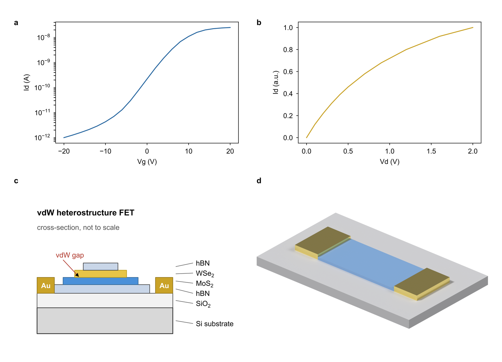
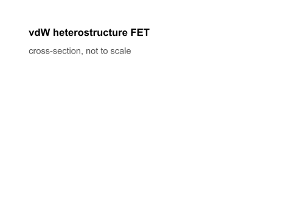

# OSDA 科学绘图技能


> **English**: OSDA turns a declarative JSON scene into editable vector figures (SVG/PDF) and, when needed, 3D assets rendered by Blender. It targets publication-quality scientific figures: millimetre-accurate layout, journal checks, multi-panel composition, progressive GIF and a build replay. Vector export needs Inkscape; 3D is optional.





三个子系统，职责分开：

| 子系统 | 负责 | 不负责 |
|---|---|---|
| `osda_scene` | JSON Scene Spec → 布局、后端路由、progressive、swarm、合规校验 | 不直接操作 Blender 内部 |
| `osda_vector` | 按毫米坐标生成 SVG、导出 PDF/PNG、多图排版 | 3D 渲染 |
| `osda_render` | `.blend` / `build.py` → PNG，可选视觉审核 | 矢量、排版、字号 |

三者通过“Scene Spec + 位图 + `meta.json`”衔接：3D 渲染出透明背景 PNG，按物理尺寸贴回矢量版面。

## 它做什么 / 不做什么

| 做 | 不做 |
|---|---|
| 2D 示意图、器件截面、流程图（矢量、可编辑） | 不做位图描摹/截图复刻 |
| 数据图（matplotlib SVG）与自绘图混合排版 | 不做 LaTeX 公式 |
| 探测局域网 GPU 是否空闲，空闲则提交容器渲染 | 不发布渲染镜像 |
| 失败回退本地 CPU Cycles | 不替代人工判断 |
| 校验 `meta.json`、透明通道、字号、线宽、文本完整性 | 不做期刊投稿终审 |

## 快速开始（不需要 Blender / GPU）

```bash
python -m osda_render --script templates/build_3d.py --renderer mock --outdir outputs/demo
```

产物：

```
outputs/demo/
├── iter_01/
│   ├── scene.blend
│   ├── meta.json
│   └── render_0001.png
└── summary.json
```

`summary.json` 里会记录 `renderer_used`，mock 模式不会伪装成真实渲染。

## Scene Spec（推荐入口）

用 JSON 描述整张图，由渲染器统一处理布局、后端、导出与校验：

```bash
python -m osda_scene --spec examples/specs/heterostructure.json --outdir outputs/demo
```

产物：`*.svg` / `*.pdf` / `*.png` / 可选 `*.tiff`、`summary.json`；开启 progressive 会额外生成 `frames/` 与 GIF，开启 swarm 生成自包含 HTML。

Schema 在 [`schema/scene.schema.json`](schema/scene.schema.json)（JSON Schema 2020-12），校验用本机已有的 `jsonschema`，无需 pydantic。

| 能力 | 说明 |
|---|---|
| 元素类型 | `rect` / `circle` / `line` / `arrow` / `path` / `text` / `image` / `panel` / `data_plot` / `blender_asset` |
| 布局 | `free`（给坐标）或 `grid`（给 `cell: [row, col]`，自动算单元格） |
| 后端 | `auto` 自动判断，也可显式 `inkscape` / `matplotlib` / `blender` / `composite` |
| 外部面板 | `panel` 支持 SVG 直接嵌入、PDF/EPS 自动经 Inkscape 转 SVG（Origin 导出可用） |
| 数据图 | `data_plot` 读 CSV，按最终物理尺寸出图，字号不随缩放失真 |
| Progressive | 按 `layout.order` 逐元素出帧 + Pillow 合成 GIF |
| Swarm | 构建回放：元素按轮廓逐段画出，光标贴着轮廓走，多光标同时绘制；短点状尾迹，切换元素/画完即清；结束后光标原地淡出 |
| 合规 | 画布尺寸、字号、线宽、文本完整性、PNG DPI 元数据、PDF 字体嵌入（启发式） |

示例：`heterostructure.json`（2D + progressive + swarm）、`panel_full.json`（2×2 混合）、`panel_grid.json`（纯数据图网格）、`asset_3d.json`（Blender 素材回填）。

`swarm` 只是演示：把最终 SVG 包成一条时间轴，元素按 stroke-dashoffset 逐段画出，光标用 `getPointAtLength()` 沿轮廓移动，多个光标分头同时画各自负责的区域。它不参与出图，也不改变任何静态产物。

CLI 参数：`--renderer auto|server|local|mock`、`--formats svg,pdf,png,tiff`、`--dpi`、`--color-mode RGB|CMYK`、`--no-progressive`、`--no-swarm`。

## 2D 矢量（osda_vector）

```python
from osda_vector import Canvas, export, verify_svg

c = Canvas(80, 56)                                  # 单位 mm
c.rect(8, 42, 47, 9, fill="#D8D8D8", stroke="#333333", stroke_pt=0.75)
c.text(8, 10, "demo", size_pt=8, weight="bold")
c.text(63, 31, "", size_pt=7, runs=[{"t": "MoS"}, {"t": "2", "sub": True}])
svg = c.save("out/fig.svg")
export(svg, "out", formats=("pdf", "png"), dpi=600)
print(verify_svg(svg, expected_size_mm=(80, 56)))
```

三条硬约定：

- 1 用户单位 = 1 mm，**字号和线宽一律用 pt 传参**，由库换算，避免 8 pt 被写成 8 mm（≈22.7 pt）；
- 化学式下标用 `runs` + `<tspan>`，不要用 U+2082（Arial 没有该字形）；
- 文字基线是 `y` 的下沿，`y` 不是文本框顶部。

示例：

```bash
python examples/fig_stack.py --outdir outputs/fig_stack
python examples/fig_panel.py --asset3d outputs/fig_stack/../3d/render_0001.png --outdir outputs/fig_panel
```

## 三种后端

| `--renderer` | 行为 |
|---|---|
| `auto`（默认） | 服务器启用且空闲 → `server`，否则 `local`；降级原因写入 `summary.json` |
| `server` | 指定服务器；不可用时仍回退本地，但会记一条 warning |
| `local` | 只用本机 Cycles CPU |
| `mock` | 不调用 Blender，用 Pillow 生成占位图，用于排版联调与 CI |

## 配置

复制 `config/render.example.toml` 到 `~/.config/osda/render.toml`，或用环境变量覆盖：

| 变量 | 含义 |
|---|---|
| `OSDA_SERVER_ENABLED` | 是否启用服务器 |
| `OSDA_SERVER_HOST` / `OSDA_SERVER_USER` | 主机与账号（**无默认值**） |
| `OSDA_SERVER_PASSWORD` / `OSDA_SSH_KEY` | 密码或私钥（二选一，**无默认值**） |
| `OSDA_BLENDER` | Blender 可执行文件路径 |
| `OSDA_SAMPLES_SERVER` / `OSDA_SAMPLES_LOCAL` | 采样数 |
| `OSDA_BUILD_TIMEOUT` / `OSDA_TIMEOUT_LOCAL` / `OSDA_TIMEOUT_SERVER` | 三类超时（秒） |
| `GLM_API_KEY` / `MIMO_API_KEY` | 审核密钥，仅在选择对应引擎时需要 |

优先级：命令行 > 环境变量 > 配置文件 > 默认值。

## 与矢量层的接缝

`build.py` 必须写 `meta.json`，否则下游无法把图贴回版面：

```json
{
  "asset_id": "fet3d",
  "resolution": [1600, 1200],
  "ortho_scale_mm": 46.0,
  "transparent": true,
  "target_width_mm": 40.0,
  "blender_version": "5.2.0 LTS"
}
```

- 声明 `transparent: true` 但 PNG 实际没有 alpha 时，默认直接失败（退出码 5）；
- 用 `--require-meta` 强制要求该文件存在。

模板见 `templates/build_3d.py`。

## 退出码

| 码 | 含义 |
|---|---|
| 0 | 成功（含 mock、含"审核未通过但流程完成"） |
| 2 | 配置错误（缺凭据、配置项非法） |
| 3 | 场景构建或渲染失败 |
| 4 | 请求了审核但拿不到结果 |
| 5 | `meta.json` 缺失/非法，或透明度声明与实际不符 |

## 已知限制

- 视觉审核前会把图缩到 2048 px，**不能**用它判断印刷分辨率是否达标；
- 审核阈值是启发式的，不是科学正确性的判据；
- 服务器模式需要 SSH + Docker + NVIDIA Container Toolkit；
- 默认不审核，也不内置任何密钥；
- **不支持 LaTeX 公式**：本机没有 pdflatex/TexText；
- **CMYK 只作用于 TIFF**，PDF 仍是 RGB（Inkscape CLI 不提供 CMYK PDF 导出）；
- **文本完整性只校验 spec 中声明的 `text` 元素**，不检查嵌入面板内部的文字；
- 嵌入面板按目标尺寸缩放，若源图不是按最终尺寸生成，内部字号会随之变化；
- 尚未提供 MCP / 多 Agent 接口。

## 许可

GPL-3.0-or-later。原因：`templates/build_3d.py` 使用 Blender Python API（`bpy`），Blender 官方要求此类脚本发布时采用 GPL 兼容许可。

**你用本工具生成的图片、PDF、SVG 归你自己所有**，不受 GPL 约束（见 Blender 官方 "Your Artwork" 条款）。

## 致谢与边界

设计思路参考了 `scientific-illustrator-agent`（该仓库**未提供任何开源许可证**），本项目**未使用其任何代码**，仅在"结构化 spec → 渲染 → 回读校验"的工作流形态上受启发。
